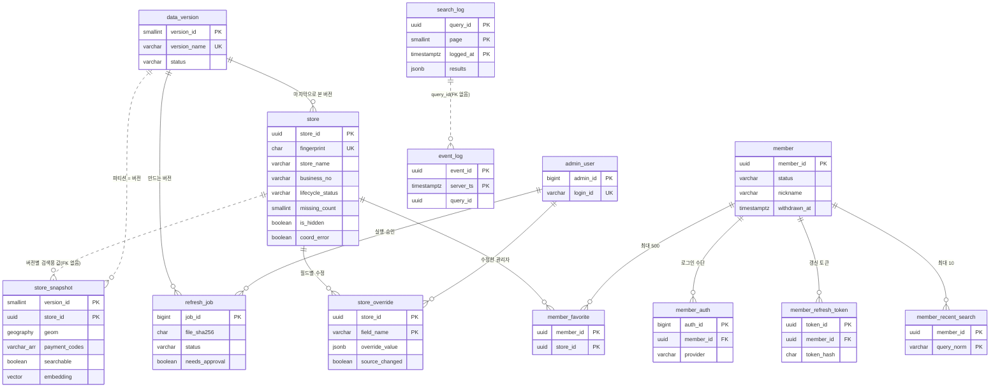

# DB 테이블 설명서

> **DB가 무엇을 갖고 어떻게 쓰이는지**를 적는 기준 문서다. 왜 이렇게 설계했는지는 [`DB_DESIGN_WHY.md`](DB_DESIGN_WHY.md).
> 실행 SQL: [`V1__init.sql`](../../backend/src/main/resources/db/migration/V1__init.sql)(Flyway) — 정확한 컬럼·제약은 SQL이 기준이다(둘이 다르면 SQL이 맞다). 관계 그림은 1절(GitHub에서 바로 보임). ERDCloud 그림은 발표·공유용으로 ERD 담당이 SQL에서 만든다.
> 입력: `docs/product/REQUIREMENTS.md`(4절 DR-01~19), `docs/product/SERVICE_POLICY.md`, `docs/search/SEARCH_HANDOFF.md`
> 검증: 로컬 Docker(PostgreSQL 16 + PostGIS 3.7 + pgvector 0.8)에서 실행 확인(2026-11-17). **실제 데이터 적재·속도 측정은 아직**(12절).
> 예전 `DB_DESIGN.md`(전체 명세)와 `erdcloud.sql`은 이 문서와 `DB_DESIGN_WHY.md`로 나눠 합쳤다(2026-11-17). 옛 파일은 AI 레포 `store-search` main에 남아 있다.
> 표기: **PK** = 기본 키(행 하나를 집어내는 값), **FK** = 다른 테이블에 꼭 있어야 하는 값(연결선). 자료형은 PostgreSQL 기준.

## 1. 한눈에 보기

테이블 **20개**, 다섯 묶음: 가맹점·갱신(5) · 참조(6) · 회원(5) · 관리자(1) · 로그·통계(3).

| 묶음 | 테이블 | 한 줄 설명 | 주요 연결 | 요구사항 |
|---|---|---|---|---|
| 가맹점·갱신 | `store` | 가게 1곳 = 1행. 원천 값 + 현재 상태 | `store_override`, `member_favorite`이 가리킴 | DR-01 |
| | `store_override` | 관리자가 고친 값(가게 × 필드) | → `store`, `admin_user` | DR-02, FR-STO |
| | `store_snapshot` | **검색이 읽는 표.** 버전 × 가게의 최종 값 + 벡터 | 버전별 파티션(FK 없음) | DR-04, DR-07 |
| | `data_version` | 데이터 버전. 활성은 언제나 하나 | `store_snapshot`, `refresh_job`이 가리킴 | DR-05 |
| | `refresh_job` | 주간 갱신 작업 1건 = 원천 파일 1개 | → `data_version`, `admin_user` | DR-06 |
| 참조 사전 | `category` | 업종 칩 17개(공식 온누리 중분류) | | DR-07, FR-MSG-04 |
| | `payment_method` | 결제 칩(카드결제·QR결제) | | DR-07, FR-MSG-04 |
| | `brand_alias` | 브랜드 대표 이름과 다른 표기 | | DR-08 |
| | `gazetteer` | 지명 사전 | | DR-09 |
| | `place_exclusion` | 지명으로 읽지 않을 말 | | DR-10 |
| | `expansion_cache` | 업종 검색어 확장어 | | DR-12 |
| 회원 | `member` | 회원 1명 = 1행. 탈퇴도 행을 남김 | `member_auth`, `member_recent_search`, `member_favorite`이 가리킴 | DR-13, DR-19 |
| | `member_auth` | 로그인 수단(카카오·구글) | → `member` | DR-13 |
| | `member_refresh_token` | 로그인 유지용 갱신 토큰(14일) | → `member` | DR-13, FR-MBR-06 |
| | `member_recent_search` | 최근 검색어 10개 | → `member` | DR-14 |
| | `member_favorite` | 관심 가맹점 500곳 | → `member`, `store` | DR-14 |
| 관리자 | `admin_user` | 관리자 계정 | 수정·갱신·숨김 기록이 가리킴 | DR-15 |
| 로그·통계 | `search_log` | **중심 로그.** 검색 결과 한 페이지 = 1행 | 월별 파티션(FK 없음) | DR-16 |
| | `event_log` | 사용자 행동(클릭·길찾기 등) | 월별 파티션(FK 없음) | DR-16 |
| | `stats_daily` | 하루 요약 숫자 | | DR-17 |

### 용어

| 용어 | 뜻 |
|---|---|
| PK(기본 키) | 행을 하나로 찾는 값. 같은 값이 두 번 들어갈 수 없다 |
| FK(외래 키) | "이 값은 저 테이블에 있어야 한다"는 약속. 없는 가게를 즐겨찾기에 넣는 것을 DB가 막는다 |
| 인덱스 | 책의 찾아보기. 조회는 빨라지고 쓰기는 조금 느려진다 |
| 파티션 | 한 테이블을 안에서 여러 칸으로 나눈 것. 칸 하나를 통째로 붙이거나 지울 수 있다 |
| 스냅샷 | 어느 시점의 데이터를 통째로 찍어 둔 사본 |
| 트랜잭션 | 여러 변경을 "전부 되거나 전부 안 되거나"로 묶은 것 |

### 관계 그림(ERD)

점선은 FK 없이 값으로만 연결된 관계다. 관계마다 왜 그 개수·FK인지는 [`DB_DESIGN_WHY.md`](DB_DESIGN_WHY.md) 3절.



참조 테이블 6개(`category`, `payment_method`, `brand_alias`, `gazetteer`, `place_exclusion`, `expansion_cache`)와 `stats_daily`는 다른 테이블과 FK가 없어 그림에서 뺐다(`brand_alias`·`place_exclusion`의 수정 관리자 FK만 있음).

## 2. 설계 원칙

1. **검색용 데이터는 버전마다 통째로 만든다.** 매주 원천 파일이 오면 `store_snapshot`의 새 파티션을 다 채운 뒤 한 번에 바꾼다. 갱신 중에도 검색은 지난 버전을 보고, 검색 한 건이 두 버전을 섞어 보지 않는다.
2. **원천 값과 관리자 수정 값을 나눈다.** 원천은 `store`에 매주 덮어쓰고, 관리자가 고친 값은 `store_override`에 따로 둔다. 원천이 바뀌어도 수정 값은 남고, 고친 필드의 원천이 바뀌면 표시가 켜진다.
3. **로그는 검색 로그 하나를 중심으로 월 단위로 쌓는다.** 한국 시간 기준 한 달마다 파티션을 나누고 1년 지난 달은 파티션째 지운다. 쓰기를 가볍게 하려고 FK를 걸지 않는다.
4. **지난 이력은 남기지 않는다.** 수정 이력, 상태 이력, 관리자 접속 기록 표는 없다. 지금 값과 마지막으로 바꾼 사람·시각·사유만 남는다. 필요해지면 표를 더한다.
5. **행을 지우지 않는 표**: `store`(폐업도 상태만 바꿈), `member`(탈퇴도 상태만 바꾸고 개인정보는 비움), `admin_user`(비활성화).

## 3. 가맹점·갱신

### `store` — 가맹점

가게 한 곳이 한 행이다. 원천 엑셀 값과 지금 상태가 같이 있다. 예: 천안의 "피양옥 신불당점".

- `store_id`는 이미 발급한 번호를 바꾸지 않는다. 평가 정답 데이터가 이 번호로 연결되어 있다. 새 가게만 새로 발급한다.
  - 첫 적재(11월 파일 = 데이터 버전 1)에서는 9월 파일의 AI 레포 store_id를 지문으로 이어받는다. 한 지문에 9월 id가 여럿이면 평가 정답에 나오는 id, 없으면 AI 레지스트리에 먼저 등록된 id를 쓴다. 나머지 id(410개)는 평가할 때 대표 id로 바꿔 읽는다.
- `fingerprint`(지문) = sha256(사업자번호 | 가맹점명 | 도로명 키). 다음 주 파일의 행이 지난주 그 가게인지 이것으로 판단한다. 구현과 예시: `store/service/StoreFingerprint`.
  - 사업자번호는 숫자만. 가맹점명은 공백·`&nbsp;`·`<br>`만 정리한다.
  - 도로명 키 = 주소의 괄호 앞까지에서 시도 이름을 빼고, 처음 나오는 번호(건물번호, `지하60`, 지번 `203-58`)까지를 공백 없이 이은 것. 번호가 도로명에 붙어 와도(`중앙대로767`) 나눠서 본다. 번호가 없으면 시도를 뺀 나머지 전체.
  - 예: "무학1길 30 (봉방동)"과 "무학1길 30 (봉방동) 김창숙미용실"은 같은 가게. 상호·건물번호·사업자번호가 바뀌면 새 가게가 된다.
  - 이렇게 한 이유(2026-11-19, 9월 → 11월 파일): 전체 주소로 보면 80.7%만 이어졌다. 상세 주소(층·호·상호)가 바뀐 행이 2만 4천 개였다. 도로명 키로 보면 89.8%가 이어지고, 평가 정답 가게의 94.8%가 11월에도 남는다.
- **같은 지문의 원천 행이 여럿이면 가게 하나로 합친다**(11월 파일: 652곳, 1,305행. 중앙값 거리 0m). 대표 행 = 좌표가 국내 범위 안인 행 → 주소가 가장 긴 행 → 파일에서 먼저 나온 행. 상호·주소·좌표·시장·업종은 대표 행 값을 쓴다. 품목은 행들의 품목을 중복 없이 이어 붙이고, 결제는 하나라도 Y면 Y. 좌표·품목·결제 중 하나라도 행끼리 다르면 `source_conflict` = true.
- **좌표 오류**(`coord_error`): 좌표가 비었거나 0이거나 국내 범위(위도 33~39.5, 경도 124~132) 밖, 또는 같은 가게 원천 행끼리 100m 넘게 다름. 11월 파일 475곳. 검색에서만 빠지고 갱신은 멈추지 않는다(정책 10-4).
- 첫 적재·주간 갱신 명령과 Colab 벡터 작업: [`docs/dev/DATA_LOAD.md`](../dev/DATA_LOAD.md).
- 사업자번호·가맹점번호·법정동코드·표준산업분류코드는 **문자열**이다. 숫자로 두면 앞자리 0이 사라진다.
- 상태(`lifecycle_status`): 원천에서 한 번 빠지면 확인 대기(`missing_count` = 1, 바로 검색에서 빠짐), 다음 주에 돌아오면 영업중, 2주 연속 빠지면 폐업(8-2절 그림).
- 숨김: 숨길 때도 풀 때도 사유가 필수다. 마지막 숨김·해제의 사유·관리자·시각을 남긴다(`ck_store_visibility`).
- **검색 대상** = 영업중 · 숨김 아님 · 좌표 오류 아님. 이 값은 스냅샷의 `searchable`로 미리 계산해 둔다.

| 컬럼 | 이름 | 자료형 | 키 | 역할 |
|---|---|---|---|---|
| `store_id` | 가맹점 ID | uuid | PK | 기존 UUID 유지(평가 정답과 연결), 새 가게만 gen_random_uuid() |
| `fingerprint` | 지문 | char(64) |  | sha256(사업자번호 \| 가맹점명 \| 도로명 키). 도로명 키 = 시도를 뺀 주소에서 첫 번호(건물번호·지번)까지, 공백 무시. 규칙은 `StoreFingerprint` |
| `store_name` | 가맹점명 | varchar(100) |  | 가맹점명(원천 값) |
| `business_no` | 사업자번호 | varchar(20) |  | 문자열(앞자리 0) |
| `merchant_no` | 가맹점번호 | varchar(20) |  | 결측·전화번호 형태 섞임, 식별자로 안 씀 |
| `address` | 주소 | varchar(200) |  | 주소 |
| `latitude` | 위도 | numeric(9, 6) |  | 원천 그대로(0 좌표 포함). 2026-11-13 파일부터 원천 열 이름은 Y좌표 |
| `longitude` | 경도 | numeric(9, 6) |  | 원천 X좌표 |
| `legal_dong_code` | 법정동코드 | varchar(10) |  | 문자열 |
| `market_type` | 시장 분류 | varchar(30) |  | 시장 분류(골목형상점가 등) |
| `market_name` | 시장명 | varchar(100) |  | 시장·상점가 이름 |
| `items` | 취급품목 | text |  | 취급품목 |
| `ksic_code` | 표준산업분류코드 | varchar(5) |  | 원천 표준산업분류코드(5자리 문자열, 미분류 00000) |
| `onnuri_category` | 온누리 중분류 | varchar(4) |  | 원천 온누리중분류(K001~K017). 비면 ksic_code로 보충 |
| `card_payment` | 카드결제 여부 | boolean |  | 원천 카드결제, 빈 값 NULL |
| `qr_payment` | QR결제 여부 | boolean |  | 원천 QR결제(이전 파일 열 이름은 모바일결제여부) |
| `source_conflict` | 원천 충돌 | boolean |  | 같은 가게 원천 행끼리 좌표·품목·결제가 다름(결제는 하나라도 Y면 Y) |
| `lifecycle_status` | 영업 상태 | varchar(10) |  | 값: active, pending, closed |
| `missing_count` | 연속 누락 주 수 | smallint |  | 연속으로 원천에 없던 주 수 |
| `status_changed_at` | 상태 변경 시각 | timestamptz |  | 상태가 마지막으로 바뀐 시각 |
| `is_hidden` | 숨김 여부 | boolean |  | 관리자 숨김 여부 |
| `visibility_reason` | 숨김·해제 사유 | varchar(200) |  | 마지막 숨김·해제 사유(둘 다 필수, FR-STO-07) |
| `visibility_changed_by` | 숨김·해제 처리자 | bigint | FK→admin_user | 마지막으로 숨기거나 해제한 관리자 |
| `visibility_changed_at` | 숨김·해제 시각 | timestamptz |  | 마지막으로 숨기거나 해제한 시각. 한 번도 안 바꿨으면 NULL |
| `coord_error` | 좌표 오류 | boolean |  | 수정 값까지 반영한 좌표가 비었거나 0·국내 밖, 또는 같은 가게 원천 행끼리 100m 넘게 다름 |
| `last_seen_version_id` | 마지막 확인 버전 | smallint | FK→data_version | 원천에서 마지막으로 본 버전 |
| `created_at` | 생성 시각 | timestamptz |  | 이 줄을 만든 시각 |
| `updated_at` | 수정 시각 | timestamptz |  | 마지막으로 바꾼 시각 |

### `store_override` — 관리자 수정 값

관리자는 필드 하나씩 고친다. 키는 가게 + 필드 이름이다.

- 고칠 수 있는 필드: 상호, 취급품목, 위치(주소·좌표·법정동코드), 시장명, 카드결제, QR결제, 업종. 1차에는 위치를 화면이 아니라 DB에서 직접 넣는다.
- `source_value_at_edit`(고칠 때의 원천 값)과 다음 주 원천 값이 다르면 `source_changed`를 켜고 `new_source_value`에 바뀐 값을 둔다. 1차에는 화면 없이 DB에서 확인한다.
- 수정을 해제하면 행을 지우고 원천 값으로 돌아간다.
- 갱신 중에 고친 값은 전환 직전에 새 버전에도 다시 적용한다(`refresh_job.edits_applied_until`).

| 컬럼 | 이름 | 자료형 | 키 | 역할 |
|---|---|---|---|---|
| `store_id` | 가맹점 ID | uuid | PK FK→store | 가게 고유 번호(평가 데이터와 같은 UUID) |
| `field_name` | 필드명 | varchar(20) | PK | 수정 대상 필드 · 값: store_name, items, location, market_name, payment_card, payment_qr, category |
| `override_value` | 수정 값 | jsonb |  | location = {lat, lng, legal_dong_code, address} |
| `source_value_at_edit` | 수정 당시 원천 값 | jsonb |  | 수정할 때의 원천 값 |
| `source_changed` | 원천 바뀜 | boolean |  | 그 뒤 원천 값이 바뀜 → 관리자 화면에 알림(FR-STO-08) |
| `new_source_value` | 새 원천 값 | jsonb |  | 바뀐 원천 값 |
| `reason` | 사유 | varchar(200) |  | 사유(필수) |
| `admin_id` | 관리자 ID | bigint | FK→admin_user | 처리한 관리자 |
| `updated_at` | 수정 시각 | timestamptz |  | 마지막으로 바꾼 시각 |

### `store_snapshot` — 검색 스냅샷(버전별)

검색이 실제로 읽는 표다. 데이터 버전마다 파티션이 하나씩 있다.

- 상호·주소 등은 원천 값에 관리자 수정을 덮어씌운 **최종 값**이다.
- `geom`은 미터 단위 거리를 바로 재는 좌표 자료형이라 "1km 안"을 정확하게 고른다.
- 업종·결제는 목록(`category_codes`, `payment_codes`)이라 값이 늘어도 열을 늘리지 않는다.
- `embedding`은 1024개 숫자로 된 의미 벡터다. 21만 곳이면 약 0.9GB.
- 벡터 근사 색인(HNSW)은 두지 않는다. 범위(1km·10km·지역)로 먼저 좁히고 그 안에서 정확히 계산한다.
- 전환: 새 파티션을 다 채운 뒤 붙이기·활성 버전 바꾸기를 한 트랜잭션으로 한다. 직전 버전 하나만 남기고 더 오래된 파티션은 지운다(이미 돌던 검색이 끝까지 읽고, 다음 갱신 때 바뀌지 않은 가게의 벡터를 복사해 쓰려고).

| 컬럼 | 이름 | 자료형 | 키 | 역할 |
|---|---|---|---|---|
| `version_id` | 데이터 버전 ID | smallint | PK | data_version.version_id |
| `store_id` | 가맹점 ID | uuid | PK | store.store_id |
| `store_name` | 가맹점명 | varchar(100) |  | 원천 + 관리자 수정 = 유효 값 |
| `items` | 취급품목 | text |  | 취급품목 |
| `address` | 주소 | varchar(200) |  | 주소 |
| `address_short` | 짧은 주소 | varchar(100) |  | 시군구 + 도로명(결과 카드) |
| `legal_dong_code` | 법정동코드 | varchar(10) |  | 법정동코드(문자열 10자리) |
| `market_type` | 시장 분류 | varchar(30) |  | 시장유형(결과 카드·상세, FR-LST-03) |
| `market_name` | 시장명 | varchar(100) |  | 시장·상점가 이름 |
| `geom` | 좌표(geography) | geography(point, 4326) |  | 좌표(미터 단위 거리 계산용) |
| `category_codes` | 업종 코드 목록 | varchar(4)[] |  | 업종 칩 거르기용 목록(지금은 공식 업종 하나) |
| `primary_category` | 대표 업종 | varchar(4) |  | 대표 업종(category.category_code, K001~K017). 못 찾으면 K010 기타 |
| `category_source` | 업종 근거 | varchar(10) |  | 업종 근거: 원천 온누리중분류 / 산업분류로 보충 / 관리자 수정(DR-07) · 값: official, ksic, admin |
| `subcategory` | 세부 업종 | varchar(40) |  | 세부 업종(표준산업분류 세세분류명) |
| `payment_codes` | 결제 코드 목록 | varchar(10)[] |  | {card, qr} |
| `searchable` | 검색 대상 여부 | boolean |  | 영업중 · 숨김 아님 · 좌표 오류 아님 |
| `doc_text` | 임베딩 원문 | varchar(300) |  | 가맹점명: {상호} / 취급품목: {품목}. 300자를 넘으면 품목 쪽을 자름 |
| `embedding` | 임베딩 vector(1024) | vector(1024) |  | fp32, L2 정규화 |

### `data_version` — 데이터 버전

- 이름은 한국 날짜(`2026-11-16`). 같은 날 두 번째는 `2026-11-16.2`.
- 활성 버전은 언제나 하나(부분 유일 색인).
- 버전마다 전체·신규·변경·확인 대기·폐업·좌표 오류 건수를 남긴다.

| 컬럼 | 이름 | 자료형 | 키 | 역할 |
|---|---|---|---|---|
| `version_id` | 데이터 버전 ID | smallint | PK | 데이터 버전 번호 |
| `version_name` | 버전 이름 | varchar(20) |  | 2026-11-16, 같은 날 두 번째는 2026-11-16.2 (한국 날짜) |
| `status` | 상태 | varchar(10) |  | 상태값 · 값: building, active, retired, failed |
| `embedding_model` | 임베딩 모델 | varchar(60) |  | bge_m3_ft_mj_20261014_0743 |
| `n_total` | 전체 가게 수 | integer |  | 이번 버전 결과(관리자 화면 표시) |
| `n_new` | 신규 가게 수 | integer |  | 새로 생긴 가게 수 |
| `n_changed` | 변경 가게 수 | integer |  | 값이 바뀐 가게 수 |
| `n_pending` | 확인 대기 수 | integer |  | 이번에 확인 대기가 된 수 |
| `n_closed` | 폐업 가게 수 | integer |  | 이번에 폐업 처리된 가게 수 |
| `n_coord_error` | 좌표 오류 수 | integer |  | 좌표 오류 가게 수 |
| `created_at` | 생성 시각 | timestamptz |  | 이 줄을 만든 시각 |
| `activated_at` | 활성화 시각 | timestamptz |  | 활성 버전이 된 시각 |

### `refresh_job` — 주간 갱신 작업

원천 파일 하나로 도는 갱신 한 건이다. 1차에는 운영자가 서버에서 갱신 스크립트로 실행하고, 진행 상태를 이 표에 남긴다.

- 파일 본문은 DB에 두지 않고 저장 위치(`file_path`)와 지문(`file_sha256`)만 둔다. 이미 반영한 파일을 다시 넣으면 DB가 막는다.
- 단계: 올림 → 검사 → 차이 계산 → (승인 대기) → 임베딩 → 전환 → 완료 / 실패 / 취소.
- 스크립트도 실행할 관리자 계정을 받아 `started_by`에 넣는다. 1년 지난 작업은 지우되, 활성·직전 버전을 만든 작업은 남긴다.
- 사라지는 가게가 기준(3%)을 넘으면 `needs_approval`이 켜지고 승인을 기다린다. 원천 정리 기간에는 적용하지 않는다.
- 진행 중인 작업은 언제나 하나뿐이다(부분 유일 색인).

| 컬럼 | 이름 | 자료형 | 키 | 역할 |
|---|---|---|---|---|
| `job_id` | 작업 ID | bigint | PK | 작업 번호 |
| `file_name` | 파일 이름 | varchar(200) |  | 올린 엑셀 이름 |
| `file_path` | 파일 위치 | varchar(500) |  | 파일 저장소 위치(파일 본문은 DB에 두지 않음) |
| `file_sha256` | 파일 지문 | char(64) |  | 파일 지문 |
| `file_size` | 파일 크기 | bigint |  | 100MB 이하 |
| `target_version_id` | 대상 버전 ID | smallint | FK→data_version | 이 작업이 만드는 버전 |
| `status` | 상태 | varchar(20) |  | 상태값 · 값: uploaded, validating, diffing, awaiting_approval, approved, embedding, switching, succeeded, failed, cancelled |
| `current_step` | 지금 단계 | varchar(10) |  | 검사·차이 계산·임베딩·전환 중 지금(실패면 실패한) 단계 |
| `progress_pct` | 진행률(%) | smallint |  | 지금 단계의 진행률 0~100(화면 표시) |
| `needs_approval` | 승인 필요 | boolean |  | 사라지는 가게가 기준 %를 넘음(FR-UPD-05) |
| `preview` | 미리보기 요약 | jsonb |  | 건수, 좌표 오류·충돌 목록 |
| `error_message` | 오류 메시지 | text |  | 실패 이유 |
| `validation_errors` | 검사 오류 목록 | jsonb |  | 파일 검사에 걸린 행·열·이유(최대 100) |
| `edits_applied_until` | 수정 재적용 기준 시각 | timestamptz |  | 이 시각까지의 관리자 수정·숨김을 새 버전에 반영함(FR-UPD-07) |
| `started_by` | 실행자 | bigint | FK→admin_user | 실행한 관리자. 스크립트도 실행할 관리자 계정을 인자로 받는다 |
| `approved_by` | 승인자 | bigint | FK→admin_user | 승인한 관리자 |
| `created_at` | 생성 시각 | timestamptz |  | 이 줄을 만든 시각 |
| `finished_at` | 종료 시각 | timestamptz |  | 끝난 시각 |

## 4. 참조 사전

검색 서버가 메모리에 올려 두고 쓰는 사전이다. 표마다 `updated_at`이 있고, 검색 서버는 1분마다 이것을 확인해 바뀐 사전만 다시 읽는다. 그래서 DB에서 고친 내용이 1분 안에 검색에 반영된다.

### `category` — 업종

업종 칩 17개 = 공식 온누리 중분류(K001 식품·마트 … K017 생활서비스, `seed/category/taxonomy_v1.yaml`). 결과를 거르기만 하고 순위에는 쓰지 않는다.

- 가게 업종은 원천 파일의 `온누리중분류` 열을 그대로 쓴다(`store.onnuri_category`). 비어 있으면 표준산업분류코드(`store.ksic_code`)로 대응표 `seed/category/ksic_onnuri_v1.csv`에서 찾는다.
- 대응표 예외: 76299(개인 및 가정용품 임대업)는 코드표에 17개 밖 이름 "가정용품"으로 적혀 있어 교육·문화(K013)로 둔다. 산업분류가 없는 가게(00000)는 기타(K010).
- 맞지 않는 가게는 관리자 수정(`store_override`의 업종 필드)으로 고친다.

| 컬럼 | 이름 | 자료형 | 키 | 역할 |
|---|---|---|---|---|
| `category_code` | 업종 코드 | varchar(4) | PK | K001 식품·마트 … K017 생활서비스 |
| `name` | 이름 | varchar(20) |  | 이름 |
| `sort_order` | 정렬 순서 | smallint |  | 화면에 보여 줄 순서 |
| `is_active` | 사용 여부 | boolean |  | 사용 여부 |
| `updated_at` | 수정 시각 | timestamptz |  | 마지막으로 바꾼 시각 |

### `payment_method` — 결제 수단

결제 칩이다. 카드결제(원천 카드결제 열), QR결제(원천 QR결제 열) 두 가지.

| 컬럼 | 이름 | 자료형 | 키 | 역할 |
|---|---|---|---|---|
| `payment_code` | 결제 코드 | varchar(10) | PK | 결제 코드(card, qr) |
| `name` | 이름 | varchar(20) |  | 카드결제, QR결제 |
| `source_column` | 원천 열 | varchar(30) |  | store의 원천 열(card_payment, qr_payment). 데이터 없으면 NULL |
| `sort_order` | 정렬 순서 | smallint |  | 화면에 보여 줄 순서 |
| `is_visible` | 화면 표시 여부 | boolean |  | 칩 표시 여부 |
| `updated_at` | 수정 시각 | timestamptz |  | 마지막으로 바꾼 시각 |

### `brand_alias` — 브랜드 별칭

대표 이름 하나에 다른 표기를 한 행씩 둔다. 예: "GS25" ↔ "지에스25". 1차에는 DB에서 직접 넣고 지운다.

| 컬럼 | 이름 | 자료형 | 키 | 역할 |
|---|---|---|---|---|
| `alias_id` | 별칭 ID | bigint | PK | 별칭 번호 |
| `canonical_name` | 대표 브랜드명 | varchar(40) |  | 대표 이름(GS25) |
| `alias_text` | 별칭 | varchar(40) |  | 다른 표기(지에스25) |
| `alias_norm` | 정규화 별칭 | varchar(40) |  | 정규화(소문자·공백 제거). 한 표기는 한 브랜드에만 |
| `updated_by` | 수정자 | bigint | FK→admin_user | 마지막으로 바꾼 관리자 |
| `updated_at` | 수정 시각 | timestamptz |  | 마지막으로 바꾼 시각 |

### `gazetteer` — 지명 사전

"신촌", "대전광역시 중구" 같은 이름과 중심 좌표, 넓은 지역(시도·시군구·읍면)인지 좁은 곳(동·역·시장)인지를 둔다. "신촌 국밥"을 검색하면 여기서 신촌을 찾는다. 사전을 바꿀 때는 표를 통째로 교체한다.

| 컬럼 | 이름 | 자료형 | 키 | 역할 |
|---|---|---|---|---|
| `entry_id` | 항목 ID | bigint | PK | 항목 번호 |
| `name` | 이름 | varchar(50) |  | 신촌, 대전광역시 중구, 구리전통시장 |
| `name_norm` | 정규화 이름 | varchar(50) |  | 비교용으로 정리한 이름 |
| `kind` | 지명 종류 | varchar(10) |  | 값: sido, city, sigungu, eupmyeon, dong, hdong, station, market |
| `scope` | 지명 범위 | varchar(5) |  | area = 지역 전체, point = 1km 원 · 값: area, point |
| `code_prefix` | 법정동 코드 앞자리 | varchar(10) |  | 법정동 코드 앞자리(2·5·8자리), area일 때 |
| `center` | 중심 좌표 | geography(point, 4326) |  | 지명 중심(검색 중심으로 씀) |
| `dict_version` | 사전 버전 | varchar(30) |  | 지명 사전 버전(파일 이름·날짜, 행마다 같은 값, DR-09) |
| `evidence_count` | 근거 가게 수 | smallint |  | 같은 이름 지명 고르기용(근거 수) |
| `updated_at` | 수정 시각 | timestamptz |  | 마지막으로 바꾼 시각(검색 서버가 1분마다 확인) |

### `place_exclusion` — 지명 제외어

지명으로 읽으면 안 되는 말이다. 예: "오케이 정형외과"의 "오케이". 1차에는 DB에서 직접 넣고 지운다.

| 컬럼 | 이름 | 자료형 | 키 | 역할 |
|---|---|---|---|---|
| `term_norm` | 정규화 제외어 | varchar(50) | PK | 비교용으로 정리한 말 |
| `term` | 제외어 | varchar(50) |  | 지명으로 읽지 않을 말(원문) |
| `reason` | 사유 | varchar(200) |  | 사유(필수) |
| `updated_by` | 수정자 | bigint | FK→admin_user | 마지막으로 바꾼 관리자 |
| `updated_at` | 수정 시각 | timestamptz |  | 마지막으로 바꾼 시각 |

### `expansion_cache` — 확장어 캐시

업종 검색어를 넓혀 찾을 말이다. 예: "고기" → "삼겹살, 갈비, 정육". 키는 정규화한 전체 검색어이고, 캐시에 없으면 확장 없이 검색한다.

| 컬럼 | 이름 | 자료형 | 키 | 역할 |
|---|---|---|---|---|
| `query_norm` | 정규화 검색어 | varchar(100) | PK | 정규화한 검색어 전체(최대 50자) |
| `keywords` | 확장어 목록 | text[] |  | 고기 → {삼겹살, 갈비, 정육} |
| `model` | 생성 모델 | varchar(60) |  | 만든 LLM |
| `updated_at` | 수정 시각 | timestamptz |  | 마지막으로 바꾼 시각 |

## 5. 회원

카카오·구글 소셜 로그인만 쓰고 개인정보는 최소로 둔다. 카카오는 닉네임만, 이메일은 구글에서 동의한 경우만 받는다.

### `member` — 회원

- 닉네임은 중복을 허용한다. 없으면 `회원` + 숫자 4자리.
- 동의한 약관 묶음 버전과 동의 시각을 이 행에 둔다(약관 표 없음). 탈퇴하면 이것도 비운다.
- **탈퇴**: 행을 지우지 않고 `status`를 탈퇴로, `withdrawn_at`에 시각을 적는다. 닉네임·이메일·마지막 로그인·약관 버전·동의 시각은 그 자리에서 비우고(CHECK로 강제), 로그인 수단·최근 검색어·관심 가맹점은 바로 지운다. 남는 것은 회원 번호와 시각뿐이라 누구였는지 알 수 없다.
- 로그인 유지용 갱신 토큰은 `member_refresh_token`에 둔다(아래).

| 컬럼 | 이름 | 자료형 | 키 | 역할 |
|---|---|---|---|---|
| `member_id` | 회원 ID | uuid | PK | 회원 번호(탈퇴해도 행은 남음) |
| `status` | 상태 | varchar(10) |  | 회원 / 탈퇴. 탈퇴해도 행은 지우지 않고 개인정보만 비움 · 값: active, withdrawn |
| `nickname` | 닉네임 | varchar(12) |  | 중복 허용, 없으면 '회원1234'. 탈퇴하면 NULL |
| `email` | 이메일 | varchar(254) |  | 선택 동의. 탈퇴하면 NULL |
| `terms_version` | 약관 버전 | varchar(20) |  | 동의한 약관 묶음 버전(이용약관·개인정보·만 14세). 탈퇴하면 NULL |
| `terms_agreed_at` | 약관 동의 시각 | timestamptz |  | 약관 동의 시각(DR-19). 탈퇴하면 NULL |
| `created_at` | 생성 시각 | timestamptz |  | 가입 시각 |
| `last_login_at` | 마지막 로그인 | timestamptz |  | 탈퇴하면 NULL |
| `withdrawn_at` | 탈퇴 시각 | timestamptz |  | 탈퇴 시각 |

### `member_auth` — 회원 로그인 수단

한 회원이 카카오와 구글을 둘 다 연결할 수 있어서 따로 둔다. 제공자 + 제공자 사용자 ID만 저장한다.

| 컬럼 | 이름 | 자료형 | 키 | 역할 |
|---|---|---|---|---|
| `auth_id` | 로그인 수단 ID | bigint | PK | 로그인 수단 번호 |
| `member_id` | 회원 ID | uuid | FK→member | 회원 번호(탈퇴하면 이 줄은 삭제) |
| `provider` | 로그인 제공자 | varchar(10) |  | 값: kakao, google |
| `provider_user_id` | 제공자 회원 ID | varchar(255) |  | 카카오·구글이 준 회원 번호 |
| `created_at` | 생성 시각 | timestamptz |  | 이 줄을 만든 시각 |

### `member_refresh_token` — 갱신 토큰

로그인을 14일 유지하는 토큰이다. PoC는 서버 1대라 Redis 대신 DB 표에 둔다(2026-11-16).

- 토큰 원문은 저장하지 않고 해시(`token_hash`)만 둔다. DB가 새어도 토큰을 쓸 수 없다.
- 한 번 쓰면 새 토큰을 주고 옛 토큰에 `used_at`을 적는다. 이미 쓴 토큰이 다시 오면 탈취로 보고 같은 묶음(`family_id`) 토큰을 모두 폐기한다.
- 로그아웃하면 폐기(`revoked_at`), 탈퇴하면 행을 지운다. 만료된 토큰은 매일 지운다.

| 컬럼 | 이름 | 자료형 | 키 | 역할 |
|---|---|---|---|---|
| `token_id` | 토큰 ID | uuid | PK | 토큰 번호 |
| `member_id` | 회원 ID | uuid | FK→member | 회원 번호(탈퇴하면 이 줄은 삭제) |
| `family_id` | 토큰 묶음 ID | uuid |  | 같은 로그인에서 이어 받은 토큰 묶음. 이미 쓴 토큰이 다시 오면 묶음 전체 폐기 |
| `token_hash` | 토큰 해시 | char(64) |  | sha256(토큰) |
| `expires_at` | 만료 시각 | timestamptz |  | 발급 + 14일 |
| `used_at` | 사용 시각 | timestamptz |  | 새 토큰으로 바꿔 준 시각(한 번만 쓸 수 있음) |
| `revoked_at` | 폐기 시각 | timestamptz |  | 로그아웃·탈취 의심으로 폐기한 시각 |
| `created_at` | 생성 시각 | timestamptz |  | 이 줄을 만든 시각 |

### `member_recent_search` — 최근 검색어

회원당 10개. 좌표와 `query_id`는 넣지 않는다(분석 로그와 회원이 이어지지 않게).

| 컬럼 | 이름 | 자료형 | 키 | 역할 |
|---|---|---|---|---|
| `member_id` | 회원 ID | uuid | PK FK→member | 회원 번호(탈퇴하면 이 줄은 삭제) |
| `query_norm` | 정규화 검색어 | varchar(100) | PK | 같은 말은 한 줄(다시 검색하면 시각만 갱신) |
| `query_text` | 검색어 | varchar(50) |  | 마지막 원문 |
| `searched_at` | 검색 시각 | timestamptz |  | 마지막으로 검색한 시각(정렬 기준) |

### `member_favorite` — 관심 가맹점

회원당 500곳. 같은 가게를 두 번 넣어도 한 번만 들어간다. 가게가 폐업 확정되거나 숨겨지면 지운다(확인 대기 동안은 남김).

| 컬럼 | 이름 | 자료형 | 키 | 역할 |
|---|---|---|---|---|
| `member_id` | 회원 ID | uuid | PK FK→member | 회원 번호(탈퇴하면 이 줄은 삭제) |
| `store_id` | 가맹점 ID | uuid | PK FK→store | 가게 고유 번호(평가 데이터와 같은 UUID) |
| `created_at` | 생성 시각 | timestamptz |  | 이 줄을 만든 시각 |

## 6. 관리자

### `admin_user` — 관리자

- 권한은 한 단계. 계정은 지우지 않고 비활성화한다.
- 비밀번호는 bcrypt 해시만 둔다. 5회 연속 틀리면 30분 잠금(`locked_until`). 첫 로그인 때 비밀번호 변경을 강제한다(`must_change_password`).
- 1차에는 계정 생성·비활성화·초기화를 DB·스크립트로 한다.
- 관리자 접속 기록은 남기지 않는다.

| 컬럼 | 이름 | 자료형 | 키 | 역할 |
|---|---|---|---|---|
| `admin_id` | 관리자 ID | bigint | PK | 관리자 번호(자동 증가) |
| `login_id` | 로그인 ID | varchar(30) |  | 로그인 아이디(중복 불가) |
| `password_hash` | 비밀번호 해시 | varchar(100) |  | bcrypt |
| `status` | 상태 | varchar(10) |  | 상태값 · 값: active, disabled |
| `must_change_password` | 비밀번호 변경 필요 | boolean |  | 첫 로그인 때 비밀번호 변경 |
| `failed_login_count` | 로그인 실패 횟수 | smallint |  | 연속 로그인 실패 횟수(기준을 넘으면 잠금) |
| `locked_until` | 잠금 해제 시각 | timestamptz |  | 실패가 쌓이면 이 시각까지 잠금 |
| `last_login_at` | 마지막 로그인 | timestamptz |  | 마지막 로그인 시각 |
| `created_at` | 생성 시각 | timestamptz |  | 이 줄을 만든 시각 |

## 7. 로그·통계

회원 ID는 넣지 않는다. 세션 번호와 100m 격자 위치만 남긴다. `search_log`·`event_log`는 한국 시간 기준 월별 파티션이고 1년 지난 달은 파티션째 지운다.

### `search_log` — 검색 로그

검색 결과 한 페이지를 보여 줄 때마다 한 행이다. 다음 페이지를 보면 같은 `query_id`에 `page`만 다른 행이 생긴다.

- `results`: 그때 보여 준 가게 목록(가게·순위·검색 중심 거리·점수). "이 검색에서 3위가 무엇이었나"를 이 한 행으로 본다.
- `corpus_version_id`, `pipeline_version`: 어느 데이터 버전·정책으로 검색했는지. 결과를 다시 따져 볼 때 필요하다.
- `is_bot`, `is_fallback`: 봇이나 임베딩 장애 때 검색을 품질 통계에서 빼려고 표시한다.

| 컬럼 | 이름 | 자료형 | 키 | 역할 |
|---|---|---|---|---|
| `query_id` | 검색 ID | uuid | PK | 검색 1건(다음 페이지도 같은 번호) |
| `page` | 페이지 | smallint | PK | 페이지 번호(다음 페이지도 같은 검색 ID) |
| `logged_at` | 기록 시각 | timestamptz | PK | 서버 시각 |
| `session_id` | 세션 ID | uuid |  | 30분 쉬면 새 세션 |
| `schema_version` | 로그 형식 버전 | smallint |  | 로그 형식 버전 |
| `app_version` | 앱 버전 | varchar(20) |  | 앱 버전 |
| `pipeline_version` | 검색 정책 버전 | varchar(20) |  | 검색 정책·계수 버전 |
| `corpus_version_id` | 데이터 버전 ID | smallint |  | 검색한 데이터 버전(FK 없음) |
| `query_text` | 검색어 | varchar(50) |  | 검색어 없는 조회는 NULL |
| `input_type` | 입력 방식 | varchar(15) |  | 값: typed, recent, chip, region_view, region_choice, place_store, autocomplete, browse, place |
| `category_code` | 업종 코드 | varchar(4) |  | 고른 업종 칩 |
| `payment_codes` | 결제 코드 목록 | varchar(10)[] |  | 고른 결제 칩(여러 개, 빈 목록 = 전체) |
| `view` | 화면 종류 | varchar(4) |  | 목록 / 지도 · 값: list, map |
| `location_source` | 검색 중심 출처 | varchar(15) |  | 값: query_region, ui_region, map_viewport, gps, default |
| `user_cell` | 사용자 위치 격자 | varchar(20) |  | 사용자 위치 100m 격자(원 좌표 없음) |
| `viewport_cells` | 지도 화면 격자 | varchar(50) |  | 지도 화면 남서·북동 100m 격자 |
| `parsed` | 해석 결과 | jsonb |  | 해석 결과: 지역·범위·의도·상호 우선 등 |
| `intent` | 검색 의도 | varchar(10) |  | 검색 의도 · 값: name, brand, category |
| `radius_stage` | 범위 단계 | varchar(10) |  | 값: 1km, 10km, area, viewport |
| `n_relevant_first` | 첫 범위 관련 수 | smallint |  | 첫 범위(1km 등)의 관련 결과 수(확장 판단 근거) |
| `n_relevant_final` | 최종 관련 수 | smallint |  | 최종 관련 결과 수 |
| `message` | 안내 문구 코드 | varchar(25) |  | 화면에 띄운 큰 안내 문구의 코드(API `MessageCode`, 예: no_result). 문장은 저장하지 않음 |
| `sub_message` | 보조 문구 | varchar(20) |  | 작은 줄 문구 · 값: name_first, region_ambiguous, default_location |
| `expansion_cache_hit` | 확장어 캐시 적중 | boolean |  | 업종 의도일 때만 |
| `results` | 보여 준 가게 목록 | jsonb |  | 보여 준 가게: [{store_id, position, distance_m, score}] |
| `latency_ms` | 단계별 지연(ms) | jsonb |  | 단계별 지연(ms) |
| `is_fallback` | 폴백 여부 | boolean |  | 임베딩 서버 장애로 BM25만 씀 |
| `is_bot` | 봇 여부 | boolean |  | 봇으로 판정되면 true(통계 제외) |

### `event_log` — 행동 이벤트 로그

노출·클릭·길찾기·공유 같은 행동이다. 이벤트 형식 버전(`schema_version`)을 같이 남긴다. `query_id`로 어느 검색에서 나온 행동인지 잇는다. 같은 이벤트가 재전송되면 통계 때 `event_id`로 한 번만 센다.

| 컬럼 | 이름 | 자료형 | 키 | 역할 |
|---|---|---|---|---|
| `event_id` | 이벤트 ID | uuid | PK | 화면이 만든 번호. 재전송 중복은 통계 때 한 번만 셈 |
| `server_ts` | 서버 시각 | timestamptz | PK | 서버가 받은 시각(월 파티션 기준) |
| `client_ts` | 화면 시각 | timestamptz |  | 화면에서 일어난 시각 |
| `schema_version` | 로그 형식 버전 | smallint |  | 이벤트 형식 버전(FR-LOG-04) |
| `session_id` | 세션 ID | uuid |  | 세션 번호(30분 쉬면 새로 발급, 회원과 무관) |
| `query_id` | 검색 ID | uuid |  | 어느 검색에서 나온 행동인지 |
| `event_type` | 이벤트 종류 | varchar(15) |  | 값: impression, click, action, dwell, region_choice, chip_change, research_here, cluster_click, pin_click, reformulate, abandon |
| `store_id` | 가맹점 ID | uuid |  | 가게 고유 번호(평가 데이터와 같은 UUID) |
| `position` | 순위 | smallint |  | 화면 순위(1부터) |
| `action_type` | 행동 종류 | varchar(10) |  | 값: directions, favorite, share |
| `payload` | 추가 정보 | jsonb |  | 본 가게 목록, 머문 초, 고른 지역 등 |
| `is_bot` | 봇 여부 | boolean |  | 봇으로 판정되면 true(통계 제외) |

### `stats_daily` — 일별 통계

날짜 × 화면(목록·지도) × 검색 의도별 검색 수, 결과 없음, 클릭, 재검색 같은 숫자다. 관리자 통계 화면이 이것을 읽고, 1년이 지나도 계속 보관한다. 인기 검색어·결과 없는 검색어·문구별 비율은 검색 로그에서 계산하므로 1년 안 기간만 볼 수 있다.

| 컬럼 | 이름 | 자료형 | 키 | 역할 |
|---|---|---|---|---|
| `stat_date` | 통계 날짜 | date | PK | 한국 시간 날짜 |
| `view` | 화면 종류 | varchar(4) | PK | 목록 / 지도 · 값: list, map, all |
| `intent` | 검색 의도 | varchar(10) | PK | 검색 의도 · 값: name, brand, category, none, all |
| `n_search` | 검색 수 | integer |  | 봇·폴백·browse·place 제외 |
| `n_no_result` | 결과 없음 수 | integer |  | 결과 없음 수 |
| `n_expanded` | 10km 확장 수 | integer |  | 10km로 넓힘 |
| `n_reformulate` | 재검색 수 | integer |  | 바로 다시 검색 |
| `n_search_clicked` | 클릭 있는 검색 수 | integer |  | 클릭이 1번 이상 있었던 검색 |
| `sum_first_click_pos` | 첫 클릭 순위 합 | bigint |  | 평균 첫 클릭 순위 = 합 ÷ n_search_clicked |
| `n_impression` | 노출 수 | bigint |  | 노출 수 |
| `n_click` | 클릭 수 | bigint |  | 클릭 수 |
| `n_cache_lookup` | 캐시 조회 수 | integer |  | 확장어 캐시 조회 |
| `n_cache_hit` | 캐시 적중 수 | integer |  | 확장어 캐시 적중 |
| `n_fallback` | 폴백 수 | integer |  | BM25만 쓴 검색 수(품질 지표와 따로 셈) |
| `n_bot` | 봇 검색 수 | integer |  | 봇 검색 수(따로 셈) |
| `created_at` | 생성 시각 | timestamptz |  | 이 줄을 만든 시각 |

## 8. 데이터가 생기고 바뀌는 흐름

### 8-1. 흐름

```
[주간 갱신] 운영자가 서버에서 갱신 스크립트 실행(원천 엑셀 경로 + 실행 관리자 계정) → refresh_job 생성(파일 이름·지문·위치)
            → 메모리에서 원천 행 검사 → 지문으로 기존 가게와 맞춤(새로 생김·바뀜·그대로·사라짐)
            → 미리보기(건수·좌표 오류·충돌, 스크립트 결과) → 사라짐이 기준 %를 넘으면 멈추고 승인 명령을 기다림(원천 정리 기간에는 적용 안 함)
            → 새 버전(data_version, building) + 새 스냅샷 파티션 만들기
               (바뀌지 않은 가게는 이전 벡터 복사, 바뀐 가게만 임베딩 서버로)
            → 전환 트랜잭션: 그사이 관리자 수정·숨김 다시 적용 → store 원천 값·상태 반영
               → 파티션 붙이기 → 이전 버전 retired, 새 버전 active
               → 폐업·숨김 가게 즐겨찾기 삭제, 수정한 필드의 원천이 바뀌었으면 source_changed 표시
            → 실패하면 아무것도 반영되지 않고 이전 버전 그대로(FR-UPD-09)

[관리자 수정] store_override 저장 → 유효 값 다시 계산 → 활성 스냅샷의 그 가게 행 갱신(상호·품목이면 벡터도) → 1분 안 검색 반영
[검색]       활성 버전 번호로 store_snapshot 조회(범위 + 벡터) → 점수·노출·정렬은 앱 → search_log 한 줄 기록(비동기)
[회원]       가입 = member(약관 버전·동의 시각) + member_auth
             탈퇴 = member를 withdrawn으로(닉네임·이메일·약관 버전·동의 시각 비움) + 로그인 수단·갱신 토큰·최근 검색어·즐겨찾기 삭제
[로그]       매일 새벽 전날 통계 요약(stats_daily) → 매달 두 달 앞 파티션 생성, 1년 지난 달 파티션 삭제
```

### 8-2. 가게 상태

```
            (원천에서 사라짐)                (2주 연속 없음)
 active ───────────────────▶ pending ─────────────────▶ closed
   ▲                           │
   └─────(다음 주 다시 있음)────┘
 is_hidden(관리자 숨김)과 coord_error(좌표 오류)는 상태와 별개인 표시.
 검색 대상(searchable) = active AND NOT is_hidden AND NOT coord_error   (정책 10-5)
```

- `missing_count`: 연속으로 원천에 없던 주 수. 다시 나타나면 0. 2가 되면 closed. 상태가 바뀌면 `status_changed_at`을 갱신한다.
- 상태 변화의 **지난 이력은 남기지 않는다**. 지금 상태와 바뀐 시각만 있다. 주마다 몇 곳이 바뀌었는지는 `data_version`의 건수로 본다.

### 8-3. DB에 두지 않는 것

| 무엇 | 어디에 |
|---|---|
| 정책 yaml·계수, 문구·봇 기준·안전장치 %·보관 기간 등 설정값(DR-18) | 앱 설정 파일(git). 바꾸려면 배포 |
| 업로드한 엑셀 본문 | 파일 저장소(DB에는 위치·지문만) |
| 갱신 중 원천 행 비교 | 갱신 작업의 메모리(21만 줄) |
| 지점 접미사(DR-11) | 검색 서버가 스냅샷 상호에서 계산해 메모리에 |
| 결과 10분 보관(FR-LST-02) | API 서버 메모리 캐시(PoC는 서버 1대) |
| 인기·결과 없는 검색어 | 필요할 때 `search_log`에서 계산 |

### 8-4. 가정

| # | 가정 | 바뀌면 |
|---|---|---|
| A1 | 원천 결제 열은 `card_payment`·`qr_payment`(2026-11-13 파일부터 원천 열 이름이 QR결제), 칩과는 `payment_method.source_column`으로 연결 | 매핑 행만 바꿈 |
| A2 | 같은 지문의 원천 행은 가게 하나로 합친다. 대표 행 값을 쓰되 품목은 이어 붙이고 결제는 하나라도 Y면 Y, 값이 다르면 `source_conflict` 표시(3절 `store`) | 갱신 로직만 |
| A3 | 지명만 입력도 최근 검색어에 남김 | — |
| A4 | 100m 격자 ID는 문자열(예: EPSG:5179 100m 격자 행·열) | 문자열 길이 안에서 그대로 |
| A5 | 스냅샷은 활성 + 직전 1개만 남긴다 | 보관 개수 설정 |
| A6 | 폐업 가게가 같은 지문으로 다시 나타나면 active로 되살린다(즐겨찾기는 이미 지워져 복구 안 됨) | 상태 전이만 |
| A7 | 약관(이용약관·개인정보·만 14세)은 한 묶음 버전으로 동의받는다. 위치기반 약관이 필요하다는 법무 답이 오면 `member`에 동의 시각 컬럼 하나 추가 | 컬럼 추가 |
| A8 | 임베딩 모델이 바뀌면 새 데이터 버전으로 전체를 다시 만든다 | — |

## 9. 지켜야 할 규칙

### 9-1. 잘못된 데이터 막기

| 막을 것 | 방법 |
|---|---|
| 같은 가게 두 번 | `store.fingerprint` UNIQUE |
| 같은 원천 파일 두 번 반영 | `refresh_job` 조건부 UNIQUE(`file_sha256`, 성공한 작업만) — 실패한 파일은 다시 올릴 수 있다 |
| 같은 가게 즐겨찾기 두 번 | `member_favorite` PK(회원, 가게) + `ON CONFLICT DO NOTHING` |
| 같은 검색어 최근 검색어 두 번 | `member_recent_search` PK(회원, 정규화 검색어) + `ON CONFLICT DO UPDATE`(시각 갱신) |
| 같은 소셜 계정으로 두 회원 | `member_auth` UNIQUE(provider, provider_user_id) |
| 한 표기가 두 브랜드에 | `brand_alias.alias_norm` UNIQUE |
| 활성 버전 둘 / 진행 중 갱신 둘 | 조건부 UNIQUE 인덱스 |
| 숨김·해제에 사유·처리자 없음 / 2주 안 됐는데 폐업 | CHECK(`ck_store_visibility`, `ck_store_closed_missing`) |
| 탈퇴인데 개인정보가 남음 | CHECK(`ck_member_status`) |
| 없는 가게·회원 참조 | FK(로그·스냅샷 제외) |

### 9-2. 삭제와 상태 변화

| 일 | 처리 |
|---|---|
| 회원 탈퇴 | 한 트랜잭션에서 회원 행을 잠그고 → `status = 'withdrawn'`, `withdrawn_at = now()`, 닉네임·이메일·마지막 로그인·약관 버전·동의 시각 NULL → 로그인 수단·갱신 토큰·최근 검색어·즐겨찾기 삭제. 남는 것은 회원 번호·가입·탈퇴 시각뿐(DR-13, P9-4). 소셜 연결 끊기는 앱이 먼저 호출. 같은 소셜 계정으로 다시 가입하면 새 회원 |
| 가게 폐업 확정·관리자 숨김 | 가게 행은 그대로(상태만). 같은 트랜잭션에서 그 가게 즐겨찾기 삭제(정책 9-3), 활성 스냅샷 `searchable = false` |
| 가게 확인 대기 | 즐겨찾기는 지우지 않고 목록에서만 숨긴다 |
| 관리자 수정 해제 | `store_override` 행 삭제 → 원천 값으로 돌아감 |
| 원천 변경 알림 처리 | "수정 유지"면 `source_changed = false`, `source_value_at_edit = new_source_value`. "원천으로"면 행 삭제 |
| 관리자 퇴사 | 삭제하지 않고 `status = 'disabled'` |
| 이전 데이터 버전 | 활성 + 직전 1개만 남기고 파티션 `DETACH … CONCURRENTLY`(검색을 막지 않음) 후 DROP. `data_version` 행은 남김 |
| 로그 | 1년 지난 달 파티션 DROP. `stats_daily`는 계속 보관(숫자 지표만. 검색어 목록·문구별 비율은 1년 안만 볼 수 있음) |
| 갱신 작업 | `refresh_job`은 1년 지나면 삭제(DR-06). 단 활성·직전 버전을 만든 작업은 남김 |
| 갱신 토큰 | 로그아웃하면 폐기, 탈퇴하면 삭제, 만료 토큰은 매일 삭제 |

| 데이터 | 물리 삭제 / 논리 삭제 |
|---|---|
| 가게 | 논리(상태) |
| 회원 행 | 논리(상태) + 개인정보 즉시 비움 |
| 로그인 수단·갱신 토큰·최근 검색어·즐겨찾기 | 물리(탈퇴 즉시, P9-4) |
| 관리자 | 논리(비활성) |
| 로그·스냅샷 | 물리(파티션째) |

### 9-3. 동시에 요청이 들어올 때

| 상황 | 생길 문제 | 대응 |
|---|---|---|
| 즐겨찾기 버튼 두 번 | 같은 행 두 번 | PK + `ON CONFLICT DO NOTHING` |
| 즐겨찾기 500곳 직전에 두 요청 | 501곳 | 트랜잭션에서 `SELECT … FROM member WHERE member_id = ? FOR UPDATE`로 그 회원을 잠그고 → `status = 'active'` 확인 → 개수 확인 → 넣기 |
| 최근 검색어 동시 저장 | 11개 이상 | 같은 회원 잠금 → upsert → 최신 10개 밖 삭제 |
| 갱신 두 번 동시 실행 | 둘 다 진행 | 조건부 UNIQUE로 두 번째 INSERT 실패 → "진행 중" 표시(FR-UPD-08) |
| 갱신 중 관리자 수정·숨김 | 새 버전에 수정·숨김이 빠짐 | 새 버전은 `edits_applied_until`까지의 수정·숨김으로 만들고, 전환 트랜잭션에서 그 뒤 것(`store_override.updated_at`, `store.visibility_changed_at` > 기준 시각)을 다시 적용(숨김이면 그 가게 `searchable = false`). 전환은 권고 잠금(`pg_advisory_xact_lock`)을 독점, 수정은 공유로 잡는다 |
| 갱신 중 검색 | 반쯤 바뀐 데이터 | 검색은 시작할 때 활성 버전 번호 하나를 잡고 그 번호로만 조회 |
| 두 관리자가 같은 필드 수정 | 앞 값을 덮음 | `store_override.updated_at`으로 낙관적 잠금(JPA `@Version`) |
| 이벤트 재전송 | 같은 클릭 두 번 | 그대로 저장하고, 통계를 낼 때 같은 `event_id`는 한 번만 센다 |
| 같은 페이지 다시 요청 | 같은 검색 줄 두 번 | 결과 캐시(10분)에 "기록한 페이지"를 표시해 처음 볼 때만 기록 |

### 9-4. 값이 어긋날 수 있는 곳

| 곳 | 위험 | 대응 |
|---|---|---|
| 스냅샷 ↔ `store`·`store_override` | 관리자 수정이 스냅샷에 안 들어감 | 유효 값 계산을 서비스 한 곳에서만, 수정 트랜잭션에서 활성 스냅샷 행까지 갱신. 매일 일치 검사 |
| `store` 상태 ↔ 스냅샷 `searchable` | 숨겼는데 검색에 나옴 | 같은 트랜잭션에서 둘 다 |
| 스냅샷 → `store`·`data_version`(FK 없음) | 없는 가게 번호가 들어감 | 전환 전 검증 쿼리(없는 store_id 0건) |
| 스냅샷 업종·결제 목록 | 코드표에 없는 값 | 갱신 작업이 코드표에 있는 값만 넣는다 |
| 통계 요약 ↔ 원본 로그 | 요약 전에 원본 삭제 | 파티션 삭제는 그 달 모든 날짜의 `stats_daily`가 있을 때만 |

## 10. 주요 조회와 인덱스

### 10-1. 조회 예시

검색 서버는 시작할 때와 버전이 바뀔 때 활성 버전 번호(`:v`)를 읽어 들고 있는다.

```sql
-- 활성 버전
SELECT version_id FROM data_version WHERE status = 'active';

-- ① 검색 중심 반경(1km / 10km) + 벡터 유사도 상위 50
SELECT s.store_id, 1 - (s.embedding <=> :qvec) AS cosine
FROM   store_snapshot s
WHERE  s.version_id = :v AND s.searchable
  AND  ST_DWithin(s.geom, ST_SetSRID(ST_MakePoint(:lng, :lat), 4326)::geography, :radius_m)
ORDER  BY s.embedding <=> :qvec, s.store_id      -- 같은 점수면 store_id 오름차순(정책 7-5). 문서가 같은 체인점은 점수가 같다
LIMIT  50;

-- ② 넓은 지명: 법정동 코드 앞 2·5·8자리 + 벡터 상위 50
SELECT s.store_id, 1 - (s.embedding <=> :qvec) AS cosine
FROM   store_snapshot s
WHERE  s.version_id = :v AND s.searchable AND s.legal_dong_code LIKE :prefix || '%'
ORDER  BY s.embedding <=> :qvec, s.store_id
LIMIT  50;

-- ③ 지도 화면 사각형 안(이 지역에서 다시 검색) + 벡터 상위 50
SELECT s.store_id, 1 - (s.embedding <=> :qvec) AS cosine
FROM   store_snapshot s
WHERE  s.version_id = :v AND s.searchable
  AND  s.geom && ST_MakeEnvelope(:west, :south, :east, :north, 4326)::geography
ORDER  BY s.embedding <=> :qvec, s.store_id
LIMIT  50;
-- ①②③의 벡터 저장 방식(행 안 halfvec로 고르고 fp32로 다시 정렬할지)은 측정 4차 뒤 정한다(DB_SEARCH_BENCH.md)

-- ④ BM25·상호 일치로만 들어온 후보의 실제 코사인
SELECT store_id, 1 - (embedding <=> :qvec) AS cosine
FROM   store_snapshot WHERE version_id = :v AND store_id = ANY(:ids);

-- ⑤ 검색어 없는 조회: 화면 안 가게, 칩, 가까운 순 300곳
--    결제 칩은 여러 개 고를 수 있고 하나라도 되면 포함(OR, FR-MSG-04). 업종과는 AND
SELECT s.store_id, s.store_name, s.primary_category, s.market_type, s.market_name, s.payment_codes,
       ST_Y(s.geom::geometry) AS lat, ST_X(s.geom::geometry) AS lng
FROM   store_snapshot s
WHERE  s.version_id = :v AND s.searchable
  AND  s.geom && ST_MakeEnvelope(:west, :south, :east, :north, 4326)::geography
  AND  (:cat IS NULL OR :cat = ANY(s.category_codes))
  AND  (cardinality(:pays) = 0 OR s.payment_codes && :pays)   -- && = 목록이 하나라도 겹침
ORDER  BY s.geom <-> ST_SetSRID(ST_MakePoint(:lng, :lat), 4326)::geography,
          s.store_name COLLATE "C", s.store_id                     -- 같은 거리면 상호 가나다순, 그다음 store_id(API와 같은 순서)
LIMIT  300;

-- ⑤-2 겹친 가게 목록(spot, FR-MAP-11): 좌표를 소수 다섯째 자리로 반올림해 같은 가게 전부(상한 없음), 상호 가나다순
--      geom && 작은 상자로 먼저 좁혀 공간 색인을 쓰고, 반올림 비교로 옆 좌표를 뺀다
SELECT s.store_id, s.store_name, s.primary_category, s.market_type, s.market_name, s.payment_codes,
       ST_Y(s.geom::geometry) AS lat, ST_X(s.geom::geometry) AS lng
FROM   store_snapshot s
WHERE  s.version_id = :v AND s.searchable
  AND  s.geom && ST_MakeEnvelope(:lng - 0.00001, :lat - 0.00001, :lng + 0.00001, :lat + 0.00001, 4326)::geography
  AND  round(ST_Y(s.geom::geometry)::numeric, 5) = round(:lat, 5)
  AND  round(ST_X(s.geom::geometry)::numeric, 5) = round(:lng, 5)
  AND  (:cat IS NULL OR :cat = ANY(s.category_codes))
  AND  (cardinality(:pays) = 0 OR s.payment_codes && :pays)
ORDER  BY s.store_name COLLATE "C", s.store_id;

-- ⑥ 즐겨찾기 목록(확인 대기는 숨김)
SELECT f.store_id, s.store_name, s.market_type, s.market_name, s.address_short
FROM   member_favorite f
JOIN   store st ON st.store_id = f.store_id AND st.lifecycle_status = 'active'
JOIN   store_snapshot s ON s.version_id = :v AND s.store_id = f.store_id
WHERE  f.member_id = :member
ORDER  BY f.created_at DESC;

-- ⑦ 최근 검색어 10개
SELECT query_text FROM member_recent_search
WHERE  member_id = :member ORDER BY searched_at DESC LIMIT 10;

-- ⑧ 관리자 가맹점 조회(A-03): 상호·주소·시장명 부분 일치 또는 사업자번호·store_id 일치, 상태·숨김·수정 여부·업종·좌표 오류로 거르기.
--    업종은 수정 값까지 반영한 활성 스냅샷의 대표 업종. 관리자만 쓰므로 부분 일치는 훑기로 충분(LIKE 앞부분 인덱스에 기대지 않음)
SELECT s.store_id, coalesce(o.override_value #>> '{}', s.store_name) AS store_name, s.address,
       s.lifecycle_status, s.status_changed_at, s.is_hidden, s.coord_error,
       sn.primary_category, sn.market_name, sn.market_type,
       (SELECT count(*) FROM store_override x WHERE x.store_id = s.store_id) AS edited_count   -- edited = edited_count > 0
FROM   store s
LEFT   JOIN store_override o ON o.store_id = s.store_id AND o.field_name = 'store_name'
LEFT   JOIN store_snapshot sn ON sn.version_id = :active_version AND sn.store_id = s.store_id
WHERE  (:q IS NULL OR s.business_no = :q OR s.store_id::text = :q
        OR s.store_name ILIKE '%' || :q || '%' OR s.address ILIKE '%' || :q || '%' OR s.market_name ILIKE '%' || :q || '%')
  AND  (:status IS NULL OR s.lifecycle_status = :status)
  AND  (:hidden IS NULL OR s.is_hidden = :hidden)
  AND  (:coord_error IS NULL OR s.coord_error = :coord_error)
  AND  (:category IS NULL OR sn.primary_category = :category)
  AND  (:edited IS NULL OR EXISTS (SELECT 1 FROM store_override x WHERE x.store_id = s.store_id) = :edited)
ORDER  BY coalesce(o.override_value #>> '{}', s.store_name) COLLATE "C", s.store_id
LIMIT  50 OFFSET :offset;   -- 수정 값을 반영한 상호 가나다순 고정. "가나다순"은 어디서나 COLLATE "C"(유니코드 코드 순서)로 쓴다:
                            -- 한글 음절은 코드 순서가 가나다순이고, DB 기본 정렬 설정에 따라 영문·숫자·공백 순서가 달라지지 않는다
--    성능 메모(백엔드 개발 때 측정 후 결정): 검색어 없이 열면 21만 행을 훑어 상위 50건만 남기는 정렬(top-N)이라
--    관리자 몇 명이 쓰는 화면으로는 충분할 것으로 본다. 1초를 넘으면 ① 수정 값을 반영한 상호를 store에 열로 두고(수정·해제 때 갱신)
--    (그 열, store_id) 인덱스를 건 뒤 ② 뒤쪽 페이지는 OFFSET 대신 마지막 (상호, store_id) 다음부터 읽는 방식(keyset)으로 바꾼다.

-- ⑨ 원천 변경 알림 목록
SELECT store_id, field_name, override_value, new_source_value
FROM   store_override WHERE source_changed ORDER BY updated_at;

-- ⑩ 관리자 통계(기간)
SELECT * FROM stats_daily
WHERE  stat_date BETWEEN :from AND :to AND view = 'all' AND intent = 'all'
ORDER  BY stat_date;

-- ⑪ 결과 없는 검색어 상위 20(기간, 첫 페이지만): 결과 없음 + 문구 ⑤·⑥(FR-STA-02)
SELECT query_text, count(*) AS n
FROM   search_log
WHERE  logged_at >= :from AND logged_at < :to AND page = 1
  AND  (n_relevant_final = 0 OR message IN ('no_exact_name', 'weak_result'))
  AND  NOT is_bot AND input_type NOT IN ('browse', 'place')
GROUP  BY query_text ORDER BY n DESC LIMIT 20;

-- ⑫ 검색 한 건에서 보여 준 가게 펼치기(순위별 분석)
SELECT l.query_id, r->>'store_id' AS store_id, (r->>'position')::int AS position
FROM   search_log l, jsonb_array_elements(l.results) r
WHERE  l.logged_at >= :from AND l.logged_at < :to;
```

- BM25는 DB가 아니라 앱 메모리에서 계산한다(FR-RNK-03). 그래서 검색용 DB 조회는 ①~④로 충분하다.
- 업종·결제 칩은 검색에서는 점수 뒤에 앱이 거른다(정책 5-6). SQL에서 칩을 거는 것은 ⑤뿐이다.

### 10-2. 인덱스

| 인덱스 | 대상 조회 | 이유 |
|---|---|---|
| 스냅샷 파티션마다 `GIST(geom) WHERE searchable` | ①③⑤⑤-2 | 반경·사각형·가까운 순을 공간 인덱스로. 검색 대상만 담아 작게 |
| 스냅샷 파티션마다 `(legal_dong_code varchar_pattern_ops) WHERE searchable` | ② | `LIKE '3014%'` 앞부분 일치 |
| 스냅샷 PK(version_id, store_id) | ④⑥ | 특정 가게 행 |
| `store (business_no)`, `store (visibility_changed_at)` | ⑧, 전환 직전 숨김 재적용 | 사업자번호는 정확히 일치. 상호·주소·시장명 부분 검색은 훑기(21만 행, 관리자만) |
| `store_override (updated_at)`, `(updated_at) WHERE source_changed` | 전환 직전 재적용, ⑨ | |
| `member_recent_search (member_id, searched_at DESC)` | ⑦ | 먼저 회원으로 좁히고 그 안에서 시각 정렬 |
| `member_favorite (member_id, created_at DESC)`, `(store_id)` | ⑥, 폐업·숨김 때 일괄 삭제 | |
| `search_log (logged_at)`, `(session_id, logged_at)` | 통계·⑪, 재검색·봇 판단 | |
| `event_log (query_id)`, `(server_ts)` | 통계에서 검색과 이벤트 잇기 | |
| `gazetteer (name_norm)`, `brand_alias (canonical_name)` | 운영자 DB 조회(1차는 화면 없음) | 검색은 메모리에서 |

**넣지 않은 인덱스**: 스냅샷 업종·결제 배열 GIN(⑤는 화면 사각형으로 먼저 줄어듦), 관리자 중간 글자 검색용 `pg_trgm`(21만 행이면 훑어도 충분), 로그 `store_id`(가게별 로그 화면 없음), `search_log.results` GIN(통계는 기간으로 먼저 자름). 벡터 근사 색인(HNSW)도 지금은 만들지 않는다([`DB_DESIGN_WHY.md`](DB_DESIGN_WHY.md) 8절).

## 11. 테이블 만들기

- [`V1__init.sql`](../../backend/src/main/resources/db/migration/V1__init.sql) 순서: 확장(postgis·vector·pgcrypto) → 관리자 → 참조 → 버전·갱신 → 가맹점 → 스냅샷 → 회원 → 로그 → 통계 → 기본 데이터 → 예시(버전 파티션, 로그 월 파티션).
- 로컬·서버 모두 API 서버가 뜰 때 Flyway가 적용한다. JPA 자동 DDL은 끈다(파티션·조건부 인덱스·geography·vector를 JPA가 만들지 못한다).
- **구조를 바꿀 때**: [`LOCAL_DEV_SETUP.md`](../dev/LOCAL_DEV_SETUP.md) 4절 "DB 구조 바꾸기" → 이 문서의 컬럼표·1절 관계 그림을 맞추고 → 이유가 바뀌었으면 `DB_DESIGN_WHY.md`도 고친다.

## 12. 팀이 더 정할 것

| 항목 | 왜 필요한가 |
|---|---|
| 실제 데이터 적재·속도 측정 | 로컬에서 표 만들기까지만 확인했다. 특히 시도 전체·대도시 10km 검색 시간([`DB_DESIGN_WHY.md`](DB_DESIGN_WHY.md) 8절) |
| 업로드 파일 저장소(디스크 / 오브젝트 저장소) | `refresh_job.file_path` |
| 파티션 자동화(pg_partman / 앱 스케줄러) | 매달 로그 파티션 생성·삭제, 매주 스냅샷 파티션 |
| 100m 격자 ID 형식 | `user_cell`·`viewport_cells`(가정 A4) |
| 갱신 토큰 저장소 | PoC는 DB 표(`member_refresh_token`). 요청이 많아지면 Redis로 옮길 수 있게 저장 부분을 인터페이스로 감쌈 |
| JPA 매핑 | `vector`·`geography`는 Hibernate Spatial + pgvector 라이브러리 또는 네이티브 쿼리. 검색 ①~⑤는 네이티브 쿼리 추천 |

## 13. 자주 묻는 질문

| 질문 | 답 |
|---|---|
| 가게 정보가 `store`와 `store_snapshot` 두 군데 있는데 중복 아닌가? | 역할이 다르다. `store`는 매주 원천으로 덮어쓰는 원본이고, 스냅샷은 수정 값까지 합친 검색용 완성본이다. 하나로 합치면 갱신 중에 검색이 반쯤 바뀐 값을 보게 된다. |
| 지난 버전을 왜 하나 남기나? | 전환하는 순간 이미 돌던 검색이 이전 버전을 끝까지 읽어야 하고, 다음 갱신 때 바뀌지 않은 가게의 벡터를 복사해 쓴다. 되돌리기 기능은 없다. |
| 수정 이력이 없으면 누가 바꿨는지 모르지 않나? | 마지막으로 바꾼 관리자·시각·사유는 남는다. 그 전 값의 기록만 없다. 필요해지면 이력 표를 더한다. |
| 보여 준 가게를 왜 한 행에 목록으로 넣었나? | 가게마다 한 행씩 쓰면 검색 한 번에 20행이 생긴다. 목록으로 넣으면 쓰기와 보관이 단순하고, 분석할 때는 목록을 펼쳐 본다(10-1절 조회 ⑫). |
| 로그에 FK가 없으면 잘못된 값이 들어가지 않나? | 서버가 자동으로 쓰는 기록이라 잘못 들어갈 일이 적다. FK가 있으면 쓰기가 느려지고, 월 단위 삭제나 폐업 가게를 가리키는 옛 로그가 꼬인다. |
| 벡터 색인(HNSW)은 왜 없나? | 범위로 먼저 좁히고 그 안에서만 계산한다. 1km 안은 보통 361곳이다. 가장 큰 경우(시도 전체 약 4.8만 곳)도 벡터를 행 안에 두면 p95 74ms라 필요 없었다([`DB_DESIGN_WHY.md`](DB_DESIGN_WHY.md) 8절, [`DB_SEARCH_BENCH.md`](DB_SEARCH_BENCH.md)). |
| 탈퇴 회원 행을 남기면 개인정보 보관 아닌가? | 닉네임·이메일은 비우고 로그인 수단은 지워서, 남는 것은 의미 없는 회원 번호와 시각뿐이다. |
| 결제 수단이 늘면 열을 추가해야 하나? | 아니다. `payment_method`에 한 행 넣고, 스냅샷 결제 목록에 값만 넣는다. |

